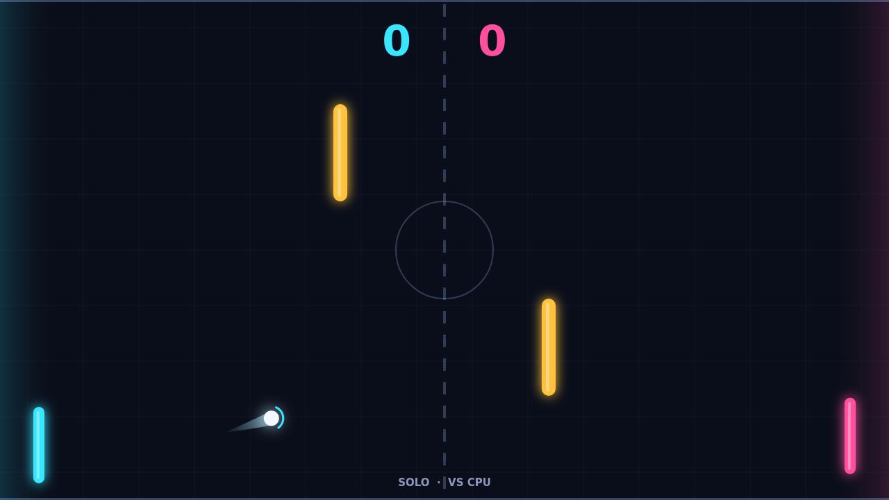

# Carom

Carom is a top-down paddle duel on a dark neon field. You hold the left paddle,
your rival holds the right, and a single glowing ball ricochets between you, off
the top and bottom walls, and off two amber pylons standing in the middle of
the court. Slip the ball past your opponent's paddle and the point is yours.
Play against a CPU that reads the ball and hustles to meet it, or hand a friend
the arrow keys and duel on one keyboard.

Every point opens with the ball waiting at center while a ring counts down the
serve, then it sets off toward whoever just lost the last point. Early rallies
are calm: the serve is gentle and you have time to line up. Each return comes
back a little faster, though, and by the tenth exchange the ball is screaming
across the court. First to eleven wins, but you must lead by two, so a tight
match can stretch well past 10–10 as both sides scrap for the decisive pair of
points.

Where the ball meets your paddle sets its angle: dead center sends it straight
back, the tips send it raking off at a steep slant. The real trick is spin.
Swing your paddle up or down at the instant of contact and the ball comes off
curving, bending across the court in a long arc that fades as it flies. A
down-swing hooks it one way, an up-swing the other, and the trail behind the
ball draws the bend for you.

The pylons turn every rally into a bank-shot puzzle. A straight drive can clip
one and come back at you; a curved one can slide around it, or kiss off its end
and dive for the far corner. Learning to thread spin past the pylons, and to
read where your opponent's curler is going to land, is what separates a lucky
point from a winning match.
